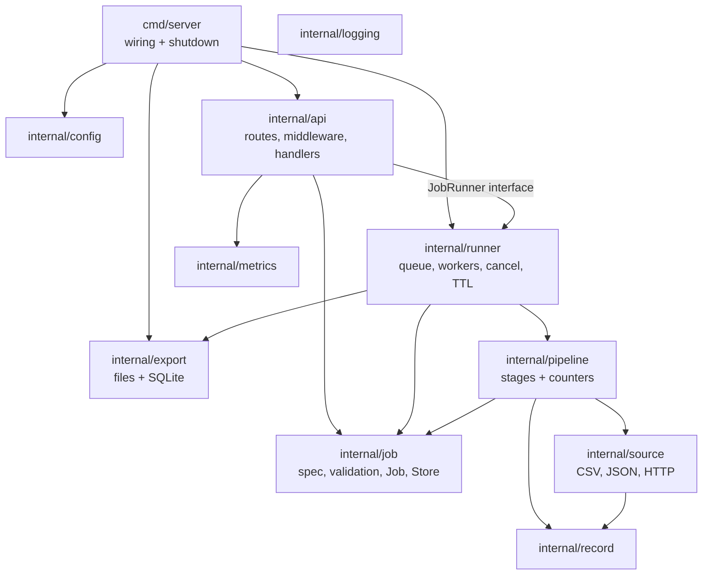
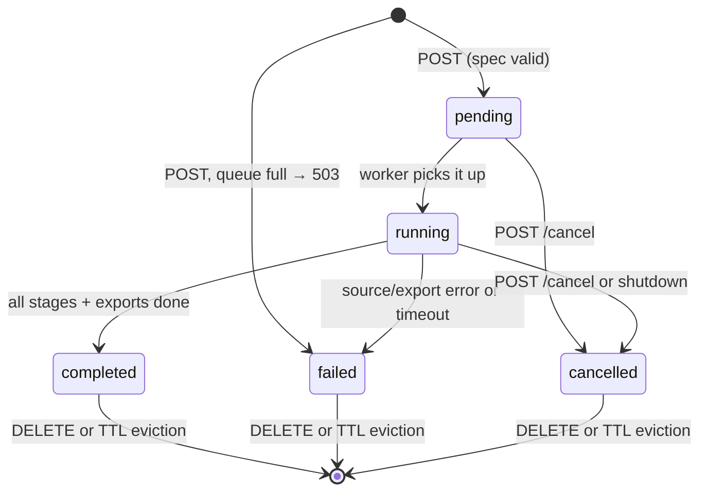
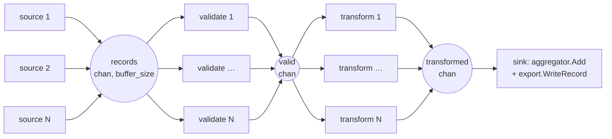

# Architecture

This document explains how datapipe is built and why: the components, how a request becomes a job, the concurrency model, how failures and cancellation are handled, and the trade-offs that were made. The [README](README.md) covers running and using it.

## Contents

1. [Goals and constraints](#1-goals-and-constraints)
2. [Components](#2-components)
3. [Request path](#3-request-path)
4. [Job lifecycle](#4-job-lifecycle)
5. [Concurrency model](#5-concurrency-model)
6. [Cancellation, timeouts and shutdown](#6-cancellation-timeouts-and-shutdown)
7. [Error handling](#7-error-handling)
8. [Storage and exports](#8-storage-and-exports)
9. [Security](#9-security)
10. [Observability](#10-observability)
11. [Performance](#11-performance)
12. [Trade-offs](#12-trade-offs)
13. [How it would scale further](#13-how-it-would-scale-further)

## 1. Goals and constraints

- Process records from several sources concurrently while keeping memory bounded, whatever the input size.
- A bad record must never stop a job. A broken source or export must fail it cleanly, without leaving partial output.
- Jobs can be watched (progress, errors, metrics), cancelled, time out, and are stopped cleanly on shutdown.
- Standard library first. The only dependency is `modernc.org/sqlite`, a pure-Go driver that keeps the binary static (`CGO_ENABLED=0`) for a distroless image.
- Minimum Go version 1.24 (`os.OpenRoot`, `ServeMux` method patterns, `slog`).

## 2. Components



| Package | Responsibility |
|---|---|
| `cmd/server` | Loads config, opens the data root and the SQLite file, builds the store, runner and HTTP handler, and runs graceful shutdown. No business logic. |
| `internal/api` | Routing (`http.ServeMux` method patterns), the middleware chain, handlers, and the embedded OpenAPI spec and Swagger UI page. |
| `internal/job` | The job spec, its validation and defaults, the `Job` model, and the `Store` interface with its in-memory implementation. |
| `internal/runner` | The bounded job queue, job workers, cancel, per-job timeout, delete, TTL eviction and shutdown. |
| `internal/pipeline` | The stages (ingest, validate, transform, sink), how they are wired, atomic counters, stage timers and the bounded error collector. |
| `internal/source` | Streaming CSV, JSON and HTTP readers behind one `Source` interface, plus the SSRF-safe HTTP client. |
| `internal/record` | The canonical `Record{Source, Index, Fields map[string]any}` and value conversion. |
| `internal/export` | Atomic JSON/CSV writers, the SQLite writer, embedded migrations, and removing a job's output. |
| `internal/metrics` | Per-job progress and the service-wide summary, computed from the store on request. |
| `internal/logging` | `slog` setup and a handler that adds `request_id` and `job_id` from the context to every log line. |
| `internal/config` | Environment variables with defaults. Every invalid value is reported at once. |

Handlers and the runner depend on **interfaces** (`job.Store`, `api.JobRunner`, `source.Source`), not on concrete types. That is what lets tests use fakes and what makes a database-backed store a contained change.

**One canonical record.** Every source produces the same `Record`, whose fields are a `map[string]any`. The job's schema, not a Go struct, decides field names and types. This lets one pipeline process CSV, JSON and HTTP data of any shape. The cost is that values are only typed after the validate stage converts them.

## 3. Request path

Every request passes through this middleware chain, outermost first. The order is deliberate:

| # | Middleware | Why it sits here |
|---|---|---|
| 1 | `requestID` | First, so every later step and every log line has the ID. Reuses a client `X-Request-ID` or generates one. |
| 2 | `logRequests` | Wraps everything below, so the log line has the final status, including a 500 from a recovered panic. |
| 3 | `recoverPanic` | Turns a handler panic into a logged stack trace and a plain `500`. |
| 4 | `securityHeaders` | Before any early return, so `401`s and preflights carry the headers too. |
| 5 | `cors` | Before the API key, because browsers send preflight `OPTIONS` without custom headers. |
| 6 | `requireAPIKey` | `/api/` routes only. Compares SHA-256 hashes with `subtle.ConstantTimeCompare`. |
| 7 | `limitBody` | `http.MaxBytesReader`, so an oversized body becomes a `413`. |

`POST /api/v1/pipelines` then does all of its work before anything runs:

1. It requires `Content-Type: application/json` and decodes exactly one object, rejecting unknown fields.
2. It applies defaults and validates the whole spec. Every problem is returned in one `400`. Transforms and aggregations are cross-checked against the fields that exist at that point.
3. It creates the job (`pending`, with the request ID) in the store.
4. It calls `runner.Submit(id)`, a **non-blocking** send to the queue. If the queue is full (or shutdown has begun), the job is marked `failed: rejected` and the client gets `503` with `Retry-After: 5`.
5. It returns `202 Accepted` with `Location: /api/v1/pipelines/{id}`.

## 4. Job lifecycle



- Every status change goes through `Store.Update(id, fn)`, which runs `fn` under the store's lock. This makes check-then-set steps atomic. For example, a worker only starts a job that is still `pending`, so a job cancelled while queued is skipped, never run.
- A running job's progress (counters and stage timings) is saved every 500 ms by a ticker goroutine.
- The final save uses `context.WithoutCancel`, so a cancelled or timed-out job can still record its final status.
- **DELETE** works only on finished jobs (`409` otherwise). It removes SQLite rows first, because that is the step that can fail when another job holds the database (5-second timeout, then `503`). Then it removes the output folder, and only then the job. A failure part-way leaves the job visible, so the delete can be retried.
- **TTL eviction** runs every minute and removes finished jobs older than `JOB_TTL` from memory only. Their output stays until an explicit delete.

## 5. Concurrency model

### Goroutines

| Goroutine | How many | Started by | Ends when |
|---|---|---|---|
| HTTP handlers | one per request | `net/http` | the response is written |
| Job worker | `JOB_WORKERS` | `runner.Start` | shutdown cancels the runner context |
| Eviction loop | 1 (if `JOB_TTL` > 0) | `runner.Start` | shutdown |
| Progress reporter | 1 per running job | the job worker | the pipeline returns |
| Source reader | 1 per source | `ingest` | the source ends, fails, or the context is cancelled |
| Validate workers | `validate_workers` per job | `runStage` | the input channel closes or the context is cancelled |
| Transform workers | `transform_workers` per job | `runStage` | the same |
| Channel closers | 1 per stage | `ingest` / `runStage` | after `wg.Wait()`, it closes the stage's output channel |

The **sink** is not a separate goroutine. It is a plain `for rec := range transformed` loop inside the job worker, which keeps aggregation and export single-threaded by construction.

### The pipeline of one job



- **Fan-in, then fan-out per stage.** Sources fan in to one channel. Each stage is a worker pool reading from the previous stage's channel and writing to its own.
- **Channel ownership.** The function that creates a channel is the only one that closes it. A dedicated goroutine waits on the stage's `WaitGroup` and then closes the output channel. Workers never close channels, so a "send on closed channel" panic cannot happen.
- **Back-pressure.** Every channel is bounded by `buffer_size` (max 5000). A slow exporter fills the buffers and pauses the sources. Memory stays proportional to `stages × buffer_size`, not to the input size.
- **Every blocking send and receive uses `select` with `ctx.Done()`.** A cancelled job never leaves a goroutine stuck on a full or empty channel. This is checked by tests that cancel mid-stream.
- **Shared state is minimal.** Counters are `atomic.Int64`. Stage timers use atomics, with a compare-and-swap loop for the maximum. The error collector has a small mutex. The aggregator and exporters are owned by the sink alone and need no locking.
- **Ordering.** Worker pools may reorder records. This is accepted: aggregation output is deterministic (groups sorted, rounding applied once at the end), and every record keeps its `source` and `index` for traceability.

### The job queue

The queue is a buffered `chan string` of job IDs (`JOB_QUEUE_SIZE`), read by a fixed number of workers (`JOB_WORKERS`). Submitting is a non-blocking `select` with a `default` branch, so an overloaded server answers `503` immediately instead of holding the request or creating a goroutine per waiting job. The number of goroutines is bounded by configuration, not by traffic.

## 6. Cancellation, timeouts and shutdown

Each job has a chain of contexts, and each layer records **why** it was cancelled (`context.WithCancelCause`):

```
runner base context      ← cancelled by Shutdown   (cause: "server shutting down")
 └─ job context          ← cancelled by POST /cancel (cause: "cancelled by user")
     └─ timeout context  ← timeout_seconds          (DeadlineExceeded)
         └─ pipeline ctx ← a source or export failure (cause: the wrapped error)
```

When the pipeline stops, the cause decides the final status:

| Cause | Status | `error` field |
|---|---|---|
| none | `completed` | — |
| user cancel, shutdown | `cancelled` | `cancelled by user` / `server shutting down` |
| deadline | `failed` | `timed out after 1m0s` |
| source or export error | `failed` | the error, e.g. `source failed: open orders.csv: …` |

Cancelling a **pending** job sets `cancelled` directly in the store, and the worker later skips it. Cancelling a **running** job calls its cancel function. That function is registered before the job is marked `running`, so a cancel that sees `running` always finds it.

**Graceful shutdown** (SIGINT/SIGTERM), bounded by `SHUTDOWN_TIMEOUT`:

1. `http.Server.Shutdown` stops accepting connections and lets in-flight requests finish, so no new jobs arrive.
2. `runner.Shutdown` cancels the base context. Running jobs stop, abort their exports and save `cancelled`.
3. Workers exit. A worker that receives a queued ID after shutdown has begun does not start it, so queued jobs stay `pending`.
4. The runner's `WaitGroup` completes, and the SQLite connection is closed last (deferred in `main`).

## 7. Error handling

Errors are split by blast radius:

| Kind | Example | Effect |
|---|---|---|
| Spec error | unknown transform op, missing field | `400` at submit, with every problem listed. Nothing runs. |
| Record error | `"abc"` as an amount, an empty required field, bad date | The record is dropped and stored as a failed record with its source, index, stage, reasons and original fields. The job continues. |
| Source error | file missing, HTTP 500, response too large | Fails the job, or is recorded and skipped with `continue_on_source_error: true`. |
| Export error | disk full, SQLite failure | Fails the job, and all exports are rolled back. |
| Panic in a handler | a bug | Recovered: logged with the stack and request ID, and the client gets `500`. |

Failed records are **bounded**: the first `max_stored_errors` (default 1000) are kept, sorted by source and index, while `records_failed` is always the full count. A file full of bad rows cannot exhaust memory.

Errors are wrapped with context (`fmt.Errorf("…: %w", err)`). Sentinel errors (`ErrNotFound`, `ErrQueueFull`, `ErrJobActive`, …) are matched with `errors.Is` and mapped to status codes in one place per handler.

## 8. Storage and exports

**Job state** (`job.Store`) is in memory: a map guarded by a `sync.RWMutex`. Reads take the read lock, and writes and `Update` take the write lock. Jobs are stored and returned by value, and every change goes through `Update`.

**Exports** are opened before the pipeline starts, receive records from the sink as they arrive, and are committed in **two phases** when it finishes:

1. *Prepare* everything that can fail: flush and `fsync` temp files, insert the remaining SQLite batches, write the aggregates.
2. *Publish*: commit the SQLite transaction, then rename the temp files to their final names.

If anything fails or the job is cancelled, `Abort` removes the temp files, rolls back the transaction and removes the empty job folder. **A job never leaves partial output.** Output paths are always `OUTPUT_DIR/<job-id>/…` and table names are fixed, so a client cannot write anywhere it chooses.

**SQLite** setup:

- WAL journal mode, so readers don't block the writer.
- `busy_timeout=5000`, plus **one open connection** (`SetMaxOpenConns(1)`). SQLite has a single writer, so callers queue in `database/sql` instead of failing with "database is locked".
- One transaction per job, and multi-row inserts of 500 rows per statement.
- Indexes on `job_id`. Record fields are stored as a JSON column (queried with `json_extract`) because each job has its own schema.
- Versioned migrations embedded in the binary (`migrations/NNN_name.sql` plus a `schema_migrations` table), each applied in its own transaction at startup.

A consequence of one connection and one transaction per job is that **jobs that export to SQLite run their pipelines one at a time**. The second job waits in `export.Open` for the connection, and that wait counts against its timeout. Jobs that only export files are unaffected. This was chosen for correctness and simplicity over write parallelism, which SQLite does not offer anyway.

## 9. Security

| Threat | Mitigation |
|---|---|
| Path traversal in source paths | Sources open files through `os.OpenRoot(DATA_DIR)`, so `../` and symlinks out of the root fail. |
| Writing anywhere via exports | The server chooses export paths (`OUTPUT_DIR/<job-id>`) and checks the job ID with `filepath.IsLocal`. |
| SSRF through HTTP sources | Only `http`/`https`. The dialer's `Control` hook rejects loopback, private, link-local and multicast addresses **at connect time**, which also covers DNS rebinding and redirects. `ALLOW_PRIVATE_SOURCES` opts out for local development. |
| Huge payloads | Request bodies are capped (`MAX_BODY_BYTES`), HTTP source responses are capped (`HTTP_SOURCE_MAX_BYTES`), spec options have upper limits (32 workers, buffer 5000, 1 h timeout, 20 sources). |
| Slow clients (Slowloris) | `ReadHeaderTimeout`, `ReadTimeout`, `WriteTimeout`, `IdleTimeout` on the server. A tuned HTTP client is used for sources. |
| Unauthorised use | Optional `API_KEY` (16+ characters) on all `/api/` routes, compared in constant time. Docs and health stay public. |
| Browser attacks | `nosniff`, `X-Frame-Options: DENY`, `Referrer-Policy: no-referrer`, CSP `default-src 'none'` and `no-store` on every response. `/docs` gets its own CSP with a script hash, and Swagger UI is loaded at a pinned version with SRI hashes. |
| Cross-origin access | CORS is off by default. When enabled, it applies only to the listed origins and sends `Vary: Origin`. |
| Container | Distroless static image (no shell, no package manager), non-root user. The data volume is the only state. |

## 10. Observability

- **Logs:** `log/slog`, JSON by default, written to stdout (12-factor; the platform collects them). A custom handler adds `request_id` and `job_id` from the context to every line, and the request ID is saved on the job. One `grep` for the request ID therefore shows the API call and the whole job run.
- **Metrics:** `GET /api/v1/metrics` (jobs by status, record totals, error rate, throughput, average and max latency per stage, goroutines) and `GET /api/v1/pipelines/{id}/progress`. Both are computed from the store on request, so there is no second source of truth to keep in sync.
- **Health:** `GET /healthz` for liveness and readiness probes. The distroless image has no shell for a `HEALTHCHECK`, so the orchestrator probes the endpoint instead.

## 11. Performance

Micro-benchmarks (`go test -bench=. ./internal/pipeline/`, Apple M5):

| Benchmark | Time per record | Allocations |
|---|---|---|
| Validate (7 typed fields) | ~334 ns | 9 |
| Transform (6 ops) | ~589 ns | 20 |
| Aggregate (3 aggregations) | ~155 ns | 4 |

A local end-to-end run over a generated 3-million-row CSV processed about **650k records/s** with aggregates only, and about **145k records/s** while also writing every record to JSON, CSV and SQLite. Memory stayed flat in both cases, because nothing holds the full dataset. These were manual runs, not an automated benchmark.

Where time goes, and the next optimisations:

- With record exports on, the single sink (serialisation plus I/O) is the bottleneck. Validate and transform scale with their worker counts.
- Aggregation is single-goroutine. Partial aggregates per worker merged at the end would remove that limit.
- `map[string]any` records cost allocations. A schema-compiled struct per job would be faster but much more complex.

## 12. Trade-offs

| Decision | Chosen | Alternative | Why |
|---|---|---|---|
| Job state | In memory behind `Store` | SQLite, Redis | Simplest correct option for one instance. The interface keeps the swap contained, and output is already durable. |
| Job queue | Buffered channel + fixed workers | Goroutine per job; RabbitMQ | Bounded resources, an explicit `503` under load, no extra infrastructure. |
| Record model | Generic map + schema | Typed structs | One pipeline for any source shape, at some cost in speed and type safety. |
| Aggregation | Single sink goroutine | Parallel partial aggregates | No locks and deterministic results. Fast enough for the target load. |
| Bad records | Drop and report | Fail the job | Real data is dirty. One bad row should not waste a whole run. |
| Exports | All-or-nothing | Stream visible output | Consumers never see half a file or half a job's rows. |
| SQLite writes | One connection, one transaction per job | Connection pool | SQLite has one writer anyway, and this removes "database is locked" errors. |
| Metrics | JSON endpoint | Prometheus | No dependency, and it meets the brief. Prometheus is the next step. |
| API docs | Hand-written OpenAPI + Swagger UI from a CDN | Code generation (swaggo) | No new dependency. A test keeps the spec and router in sync. |
| Tests | Unit tests per stage and handler | Integration and end-to-end tests | Fast and focused, including cancellation and error paths. End-to-end coverage is a known gap. |

## 13. How it would scale further

1. **Durable job state:** a SQLite or Postgres implementation of `job.Store`, plus a startup step that marks jobs left `running` as `failed: interrupted`.
2. **Several instances:** move the queue to RabbitMQ or Redis Streams, and broadcast cancel requests (pub/sub), because today the cancel function lives in the process running the job. Exports would move to Postgres or object storage.
3. **Monitoring:** a Prometheus endpoint with histograms, Go runtime metrics, alert rules (job failure rate, queue saturation) and a dashboard. OpenTelemetry tracing across the API and the job.
4. **Resilience:** panic recovery inside job goroutines (fail that job, not the process), and log rotation where logs are written to files.
