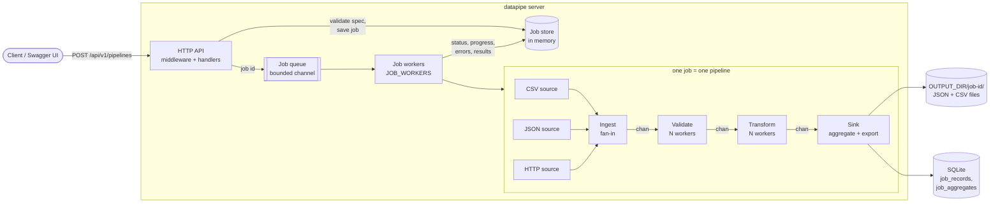

# datapipe

[](https://github.com/Abhiadi12/go-data-processing-app/actions/workflows/ci.yml)

A concurrent data processing pipeline in Go, driven by a REST API. You submit a **job spec** (JSON). The server reads records from CSV files, JSON files and HTTP APIs, then validates, transforms and aggregates them, and exports the results to files and SQLite. Every job reports its progress, failed records and metrics while it runs.

- **Sources:** CSV, JSON file and HTTP (streamed, so input size does not grow memory).
- **Stages:** ingest (fan-in) → validate (worker pool) → transform (worker pool) → aggregate + export (single sink goroutine), connected by bounded channels.
- **Jobs:** bounded queue with a fixed pool of job workers. Cancel, per-job timeout, delete, TTL eviction and graceful shutdown. A panic inside a job fails that job, not the server.
- **Errors:** a bad record is dropped and reported with its reasons. It does not stop the job.
- **Exports:** atomic JSON/CSV files and SQLite (WAL, versioned migrations, one transaction per job, batched inserts).
- **Operations:** structured `slog` logs with request and job IDs, a JSON metrics endpoint, Swagger UI, optional API key, CORS, per-IP rate limiting, a Docker image (22 MB, distroless, non-root) and CI.
- **Dependencies:** the standard library plus one module, `modernc.org/sqlite` (pure Go, so the binary builds with `CGO_ENABLED=0`).

## Contents

- [Architecture](#architecture)
- [Quick start](#quick-start)
- [Configuration](#configuration)
- [Example requests](#example-requests)
- [API reference](#api-reference)
- [Job spec](#job-spec)
- [Metrics](#metrics)
- [Project layout](#project-layout)
- [Development](#development)
- [Design decisions](#design-decisions)

## Architecture



| Stage | What it does |
|---|---|
| Ingest | One goroutine per source streams records into a single channel (fan-in). A malformed row becomes a failed record. A source that cannot be opened fails the job, unless `continue_on_source_error` is set. |
| Validate | A worker pool checks each record against the schema and converts values to their types (`int`, `float`, `bool`, `date`). A failing record is dropped with all its reasons. |
| Transform | A worker pool runs the spec's transforms in order: normalise strings, rename, set defaults, compute fields, look up reference data. |
| Sink | One goroutine aggregates (`count`/`sum`/`avg`/`min`/`max` by group) and streams records to the exporters. Because it is the only writer, it needs no locks. |
| Export | Files are written to a temp file and renamed on success. SQLite rows go into one transaction per job. A failed or cancelled job leaves no output. |

[ARCHITECTURE.md](ARCHITECTURE.md) explains the concurrency model, the job lifecycle, cancellation, shutdown and the trade-offs in detail.

## Quick start

Requirements: Go 1.24 or newer, or Docker.

### Run locally

```bash
go run ./cmd/server
```

The server listens on `:9090`. Check it and open the API docs:

```bash
curl localhost:9090/healthz
open http://localhost:9090/docs
```

Submit the example job (it reads `testdata/orders.csv` and `testdata/orders.json`):

```bash
curl -i -X POST localhost:9090/api/v1/pipelines \
  -H 'Content-Type: application/json' \
  --data @examples/orders-job.json
```

Output goes to `data/output/<job-id>/` and `data/datapipe.db`.

### Run with Docker

```bash
docker compose up --build
```

The image runs as a non-root user. Output and the SQLite file live in the `datapipe-data` volume (`/var/lib/datapipe`). The sample files are copied into the image, so the example job above works unchanged. To require an API key:

```bash
API_KEY=change-me-to-16-chars-or-more docker compose up --build
```

Without compose:

```bash
docker build -t datapipe .
docker run --rm -p 9090:9090 -v datapipe-data:/var/lib/datapipe datapipe
```

### Run the tests

```bash
go test -race ./...
go test -run='^$' -bench=. -benchmem ./internal/pipeline/
```

## Configuration

All settings are environment variables, and every one has a default. [`.env.example`](.env.example) lists them with the same defaults. The server checks all values at startup and exits with status 2, listing every invalid setting at once.

| Variable | Default | Meaning |
|---|---|---|
| `PORT` | `9090` | HTTP port |
| `LOG_LEVEL` | `info` | `debug`, `info`, `warn`, `error` |
| `LOG_FORMAT` | `json` | `json` or `text` |
| `DATA_DIR` | `.` | Directory that source `path`s are resolved in. Paths cannot escape it (`os.OpenRoot`). |
| `MAX_BODY_BYTES` | `1048576` | Maximum request body (1 MiB) |
| `READ_TIMEOUT` | `15s` | HTTP server read timeout |
| `WRITE_TIMEOUT` | `30s` | HTTP server write timeout |
| `IDLE_TIMEOUT` | `60s` | Keep-alive idle timeout |
| `SHUTDOWN_TIMEOUT` | `10s` | Time allowed for in-flight requests and running jobs to stop |
| `ALLOW_PRIVATE_SOURCES` | `false` | Allow HTTP sources on loopback/private/link-local addresses (local development only) |
| `HTTP_SOURCE_MAX_BYTES` | `52428800` | Maximum bytes read from one HTTP source (50 MiB) |
| `JOB_WORKERS` | `2` | Jobs that run at the same time (1–64) |
| `JOB_QUEUE_SIZE` | `100` | Jobs that can wait for a worker before `POST` returns `503` (1–10000) |
| `JOB_TTL` | `24h` | How long a finished job stays in memory. Its files and SQLite rows are kept. |
| `OUTPUT_DIR` | `data/output` | Root for output files (`<OUTPUT_DIR>/<job-id>/`) |
| `SQLITE_PATH` | `data/datapipe.db` | SQLite file, created and migrated at startup |
| `API_KEY` | empty | If set (16+ characters), every `/api/` request needs `X-API-Key`. `/healthz`, `/docs` and `/openapi.json` stay public. |
| `CORS_ALLOWED_ORIGINS` | empty | Comma-separated browser origins, or `*`. Empty means CORS is off. |
| `RATE_LIMIT_PER_SECOND` | `10` | `/api/` requests per second allowed per client IP (0–10000). `0` turns the limit off. |
| `RATE_LIMIT_BURST` | `20` | Requests a client may send at once before the per-second limit applies (1–10000) |

## Example requests

The full, interactive reference is **Swagger UI at [`/docs`](http://localhost:9090/docs)** (the spec is served at `/openapi.json`). Swagger UI can send every request below from the browser. If `API_KEY` is set, add `-H "X-API-Key: $API_KEY"` to each request, or use **Authorize** in Swagger UI.

The responses below were captured from a real run of `examples/orders-job.json` and are shortened with `…`. The 15 sample orders include 8 broken on purpose: a non-numeric amount, an empty customer, a negative quantity, an invalid date and so on. That is why 7 records are valid.

**Create a job** returns `202 Accepted` with a `Location` header:

```bash
curl -i -X POST localhost:9090/api/v1/pipelines \
  -H 'Content-Type: application/json' --data @examples/orders-job.json
```

```http
HTTP/1.1 202 Accepted
Location: /api/v1/pipelines/37TYXTTS4CZF5LTP46QUB7ZJYA
X-Request-Id: DGBVDCHVK77JVHAH4CYCDZ4F6C

{"id":"37TYXTTS4CZF5LTP46QUB7ZJYA","name":"daily-orders","status":"pending", …}
```

An invalid spec is rejected before anything runs, with every problem listed:

```json
{"error":"invalid job spec","details":[
  {"field":"sources","message":"at least one source is required"},
  {"field":"schema.fields","message":"at least one field is required"},
  {"field":"exports","message":"at least one export is required"}]}
```

**Get a job:**

```bash
curl localhost:9090/api/v1/pipelines/$ID
```

```json
{
  "id": "37TYXTTS4CZF5LTP46QUB7ZJYA",
  "name": "daily-orders",
  "status": "completed",
  "request_id": "DGBVDCHVK77JVHAH4CYCDZ4F6C",
  "progress": { "records_read": 15, "records_valid": 7, "records_failed": 8, "source_errors": 0 },
  "outputs": [
    { "type": "json", "content": "records", "location": "data/output/37TY…/records.json", "rows": 7 },
    { "type": "sqlite", "content": "records", "location": "job_records", "rows": 7 }
  ],
  …
}
```

**List jobs** (newest first, paginated):

```bash
curl 'localhost:9090/api/v1/pipelines?limit=10&offset=0'
```

```json
{ "jobs": [ { "id": "37TY…", "name": "daily-orders", "status": "completed", … } ],
  "count": 1, "total": 1, "limit": 10, "offset": 0 }
```

**Progress** (live while running):

```bash
curl localhost:9090/api/v1/pipelines/$ID/progress
```

```json
{
  "job_id": "37TYXTTS4CZF5LTP46QUB7ZJYA",
  "status": "completed",
  "counts": { "records_read": 15, "records_valid": 7, "records_failed": 8, "source_errors": 0 },
  "elapsed_seconds": 0.04,
  "records_per_second": 399.32,
  "percent_complete": 100,
  "stages": [
    { "stage": "validate", "records": 15, "avg_micros": 23.95, "max_micros": 245 },
    { "stage": "transform", "records": 7, "avg_micros": 38.04, "max_micros": 201.33 },
    { "stage": "sink", "records": 7, "avg_micros": 51.62, "max_micros": 213.46 }
  ]
}
```

**Results** (aggregates and output locations):

```bash
curl localhost:9090/api/v1/pipelines/$ID/results
```

```json
{
  "job_id": "37TYXTTS4CZF5LTP46QUB7ZJYA",
  "status": "completed",
  "available": true,
  "aggregates": [
    { "name": "by_category", "group_by": ["category"], "groups": [
        { "key": { "category": "books" },
          "metrics": { "count": 2, "sum_total": 561, "avg_amount": 131.25, "min_amount": 12, "max_amount": 250.5 } },
        …
    ] },
    { "name": "overall", "group_by": [], "groups": [
        { "key": {}, "metrics": { "count": 7, "sum_total": 4721.98 } } ] }
  ],
  "outputs": [ … ]
}
```

**Failed records** (the first `max_stored_errors` are kept; `total` is always the full count):

```bash
curl localhost:9090/api/v1/pipelines/$ID/errors
```

```json
{
  "job_id": "37TYXTTS4CZF5LTP46QUB7ZJYA",
  "status": "completed",
  "total": 8, "stored": 8, "complete": true,
  "errors": [
    { "source": "orders-csv", "index": 3, "stage": "validate",
      "reasons": ["amount: must be a number"],
      "record": { "order_id": "1003", "customer": "Mei Lin", "amount": "abc", … } },
    …
  ]
}
```

**Cancel** a pending or running job returns `202`. A finished job returns `409 {"error":"job has already finished"}`.

```bash
curl -i -X POST localhost:9090/api/v1/pipelines/$ID/cancel
```

**Delete** a finished job and its output (files and SQLite rows) returns `204`. A pending or running job returns `409`; cancel it first.

```bash
curl -i -X DELETE localhost:9090/api/v1/pipelines/$ID
```

**Service metrics:**

```bash
curl localhost:9090/api/v1/metrics
```

```json
{
  "jobs": { "pending": 0, "running": 0, "completed": 1, "failed": 0, "cancelled": 0 },
  "records": { "records_read": 15, "records_valid": 7, "records_failed": 8, "source_errors": 0 },
  "error_rate": 0.5333,
  "records_per_second": 399.32,
  "stages": [ … ],
  "uptime_seconds": 14,
  "goroutines": 10
}
```

The output itself is easy to inspect:

```bash
ls data/output/$ID/
sqlite3 data/datapipe.db \
  "SELECT json_extract(data,'$.customer'), json_extract(data,'$.total') FROM job_records WHERE job_id='$ID'"
```

## API reference

Base path `/api/v1`. Errors always have the shape `{"error": "...", "details": [...]}` (`details` only for spec validation).

| Method & path | Success | Other responses |
|---|---|---|
| `GET /healthz` | `200` | — |
| `POST /api/v1/pipelines` | `202` + `Location` | `400` invalid JSON/spec, `413` body too large, `415` not JSON, `503` + `Retry-After` queue full or shutting down |
| `GET /api/v1/pipelines?limit=&offset=` | `200` | `400` bad `limit` (1–500, default 50) or `offset` |
| `GET /api/v1/pipelines/{id}` | `200` | `404` |
| `DELETE /api/v1/pipelines/{id}` | `204` | `404`, `409` still pending/running, `503` + `Retry-After` database busy |
| `POST /api/v1/pipelines/{id}/cancel` | `202` | `404`, `409` already finished |
| `GET /api/v1/pipelines/{id}/progress` | `200` | `404` |
| `GET /api/v1/pipelines/{id}/results` | `200` | `404` |
| `GET /api/v1/pipelines/{id}/errors` | `200` | `404` |
| `GET /api/v1/metrics` | `200` | — |
| `GET /docs`, `GET /openapi.json` | `200` | — |

With `API_KEY` set, every `/api/` route also returns `401` when the key is missing or wrong. A client over the rate limit gets `429` with `Retry-After` on any `/api/` route. A wrong method returns `405` and an unknown path `404`.

Every response carries `X-Request-ID`. A client-supplied ID is reused, otherwise one is generated. The ID is also saved on the job and appears in every log line for that request and that job.

## Job spec

The body of `POST /api/v1/pipelines`. [`examples/orders-job.json`](examples/orders-job.json) is a complete example, and Swagger UI has it as a ready-made request. Unknown keys are rejected, and the whole spec is checked before any source is read.

| Section | Contents |
|---|---|
| `name` | Job name (required, at most 100 characters) |
| `sources` | 1–20 sources. `{"name", "type": "csv"\|"json", "path"}` with a path relative to `DATA_DIR`, or `{"name", "type": "http", "url", "timeout_ms"}`. `records_path` picks the array inside a JSON object, for example `"results"`. |
| `schema.fields` | `{"name", "type": "string"\|"int"\|"float"\|"bool"\|"date", "required", "min", "max", "pattern", "allowed", "format"}`. `min`/`max` limit the value for numbers and the length for strings. `format` is a Go date layout (default `2006-01-02`). |
| `schema.unknown_fields` | `drop` (default) or `keep` fields not in the schema |
| `transforms` | Run in order: `trim`, `lowercase`, `uppercase`, `title` (on `fields`), `rename` (`from` → `to`), `default` (`field` = `value` if missing), `multiply` (`target` = product of `fields`), `lookup` (`target` = `table[field]` or `default`) |
| `aggregations` | `{"name", "group_by": [...], "metrics": [{"op": "count"\|"sum"\|"avg"\|"min"\|"max", "field"}]}`. `group_by: []` is one group for the whole job. Metric names are `count` and `<op>_<field>`. Groups are sorted by key, and values are rounded to 2 decimals. |
| `exports` | `{"type": "json"\|"csv"\|"sqlite", "content": "records"\|"aggregates"}`. Files go to `OUTPUT_DIR/<job-id>/records.json`, `records.csv`, `aggregates.json` and `aggregates.csv`; SQLite goes to tables `job_records` and `job_aggregates`. Clients cannot choose paths or table names. |
| `options` | `validate_workers` and `transform_workers` (default 4, max 32), `buffer_size` (100, max 5000), `timeout_seconds` (60, max 3600), `max_stored_errors` (1000, max 100000), `continue_on_source_error` (false) |

A transform or aggregation that uses a field that does not exist at that point is rejected at submit time.

## Metrics

Metrics are JSON, computed from the job store on each request.

| Field | Meaning |
|---|---|
| `jobs` | Number of jobs in each status (all five are always listed) |
| `records.records_read` | Records read from all sources, including malformed ones |
| `records.records_valid` | Records that passed every stage and reached the sink |
| `records.records_failed` | Records dropped by ingest, validate or transform |
| `records.source_errors` | Sources that failed to open or read |
| `error_rate` | `(records_failed + source_errors) / records_read` |
| `records_per_second` | Records read ÷ time spent running, over all started jobs |
| `stages[]` | Per stage (`validate`, `transform`, `sink`): records handled, average and maximum time per record in µs |
| `uptime_seconds`, `goroutines` | Process uptime and current goroutine count |

Per-job `/progress` adds `elapsed_seconds` and `percent_complete`. The percentage is `0` while pending and `100` when completed. While running it is `null`, because sources are streamed and the total is not known in advance.

## Project layout

```
cmd/server/          entry point: config, wiring, start, graceful shutdown
internal/api/        routing, middleware, handlers, embedded OpenAPI spec + Swagger UI page
internal/config/     environment variables, defaults and validation
internal/job/        job spec, validation, job model, Store interface + in-memory store
internal/runner/     bounded job queue, job workers, cancel, timeout, delete, TTL eviction
internal/pipeline/   stages and their wiring: ingest, validate, transform, aggregate, counters
internal/source/     CSV, JSON and HTTP readers (streaming), SSRF-safe HTTP client
internal/record/     the canonical Record type and value conversion
internal/export/     atomic JSON/CSV writers, SQLite writer, embedded migrations
internal/metrics/    per-job progress and service-wide summary
internal/logging/    slog setup; adds request_id and job_id from the context to every line
examples/            example job spec (also used by tests and the Swagger examples)
testdata/            sample CSV and JSON inputs
```

## Development

```bash
gofmt -l .                        # must print nothing
go vet ./...
go test -race -count=1 ./...
golangci-lint run ./...           # config in .golangci.yml
./scripts/setup.sh               # once per clone: turns on the git hooks (fmt, vet, tests + Conventional Commits)
```

CI (`.github/workflows/ci.yml`) runs on every pull request and every push to `main`:

- **lint:** `gofmt`, `go vet`, golangci-lint and `govulncheck`.
- **test:** build and `go test -race` on Go 1.24 and the latest stable Go, with a coverage summary on the job page.
- **docker:** builds the image, starts it, waits for `/healthz` and submits the example job (expects `202`).

`internal/api/docs_test.go` fails if a route is added without updating `openapi.json`, or if a spec example stops passing validation.

## Design decisions

The short version. [ARCHITECTURE.md](ARCHITECTURE.md) has the reasoning.

- **Channels between stages, worker pools inside stages.** Bounded buffers give back-pressure: a slow exporter slows ingest instead of filling memory.
- **One sink goroutine** owns aggregation and export, so neither needs a lock and export streams record by record (memory stays flat for large inputs).
- **Bounded job queue** (a buffered channel plus a fixed number of workers). A full queue returns `503` instead of starting unlimited goroutines.
- **Rate limiting before the queue.** A token bucket per client IP answers `429` early, so one client cannot flood the API until the queue is full. `/healthz` and the docs are not limited.
- **A panic fails one job, not the server.** Every pipeline goroutine recovers its own panics and cancels the job with the stage and the panic value; the stack trace goes to the log.
- **Jobs are detached from the HTTP request.** They run on the runner's own context with their own cancel and timeout, and only the request ID is carried over. Cancel, timeout and shutdown each carry a cause, so the job records why it stopped.
- **Record errors are data, not failures.** A bad row is dropped and stored (bounded), while a broken source or export fails the job.
- **Exports are all-or-nothing**: temp file + rename for files, one transaction per job for SQLite.
- **Security:** source paths are confined to `DATA_DIR` by `os.OpenRoot`, export paths are chosen by the server, and HTTP sources refuse private and loopback addresses at connect time (blocks SSRF and DNS rebinding) and are size-limited. The API has request-body limits, security headers, an optional API key (constant-time compare) and server timeouts.
- **Standard library first:** `net/http` routing, `log/slog` and JSON metrics. The only dependency is a pure-Go SQLite driver.
